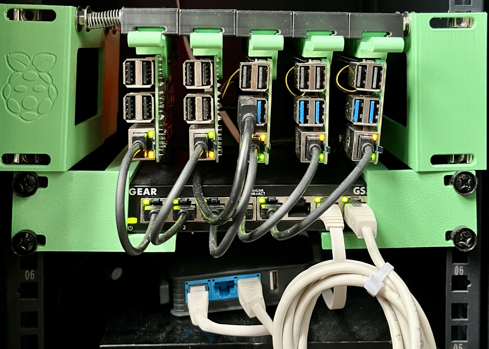
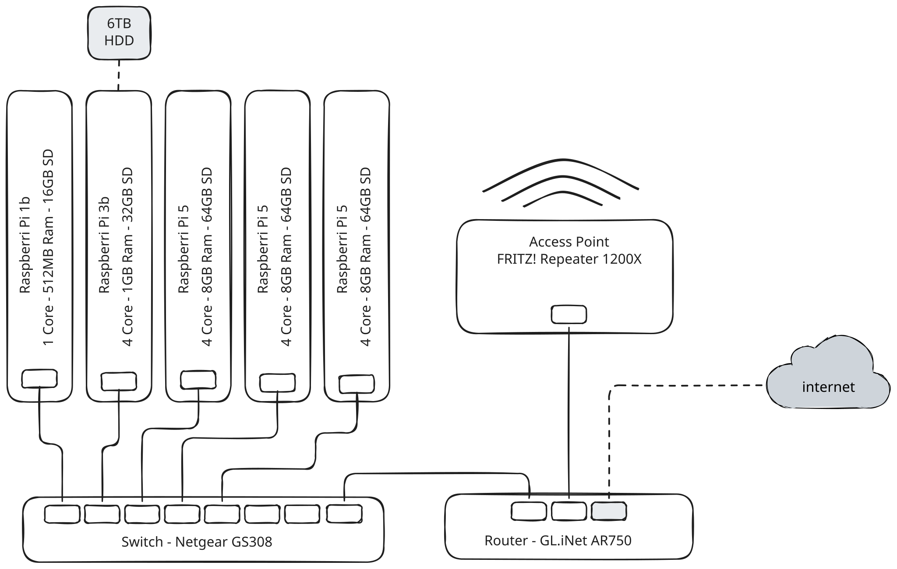
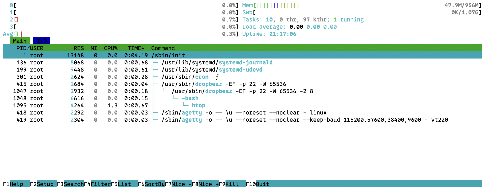
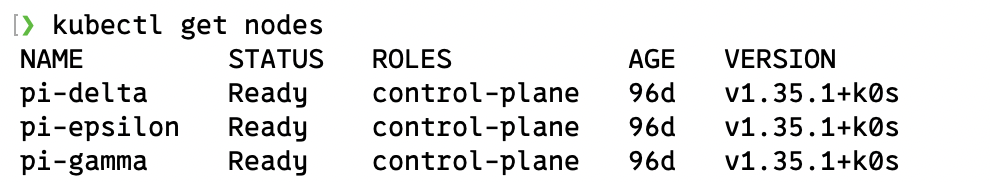
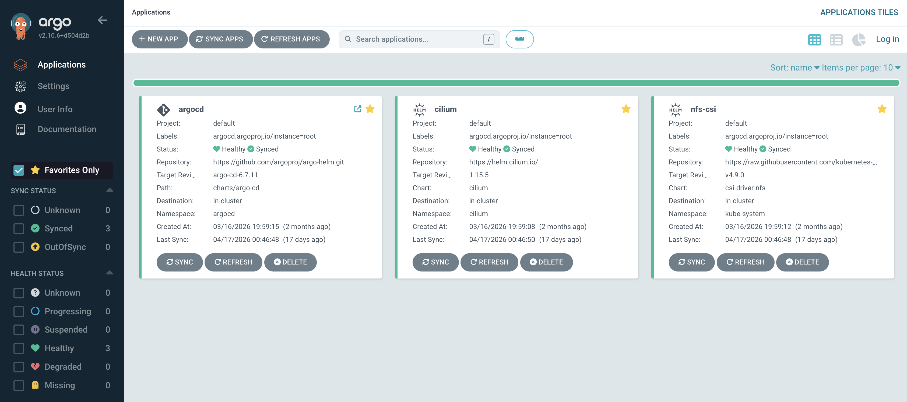
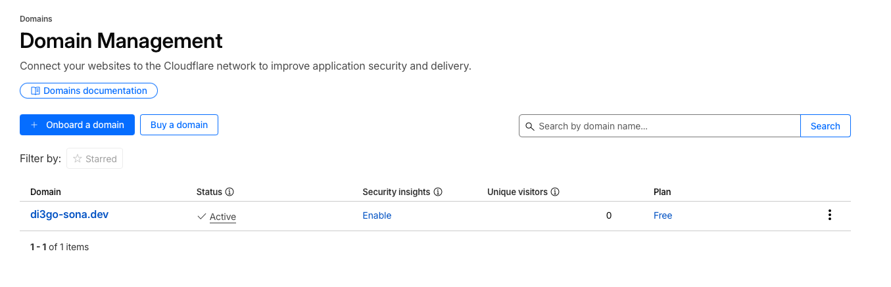
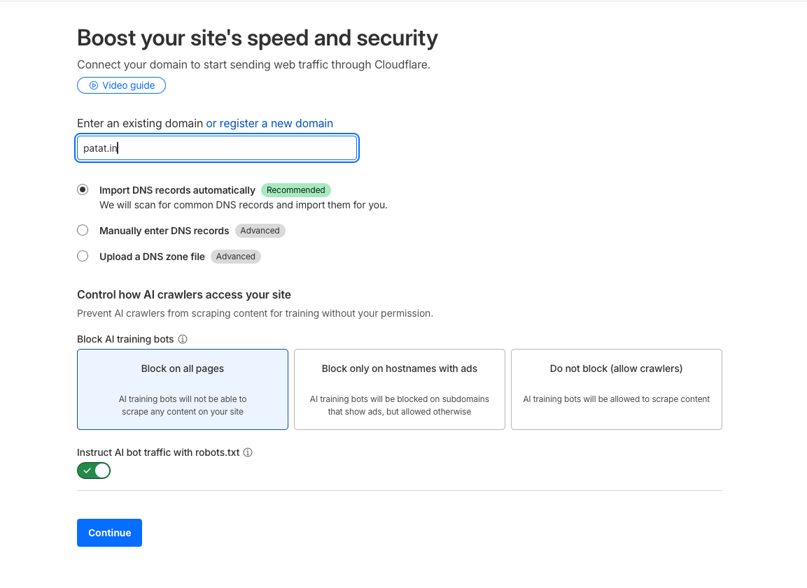
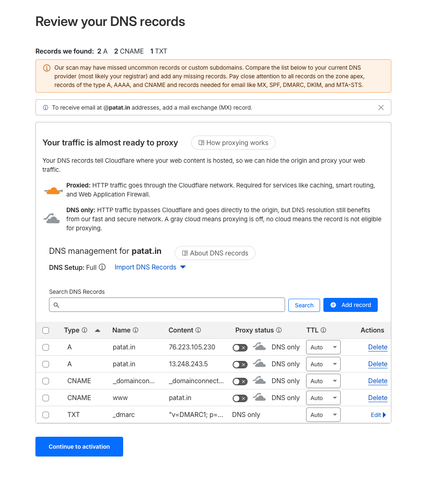
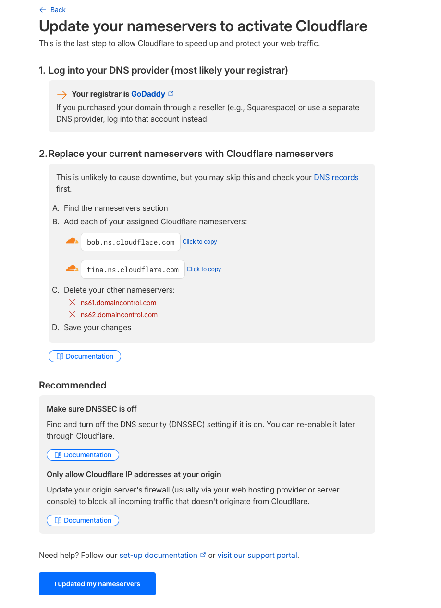
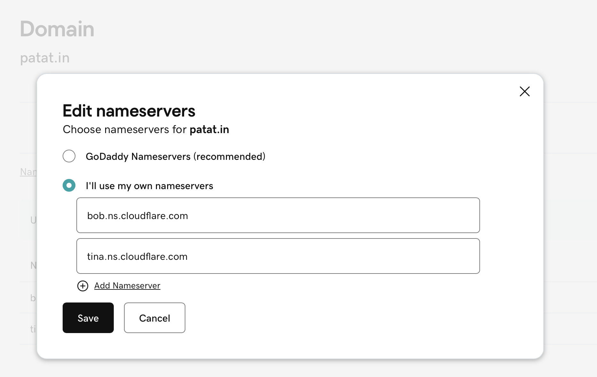

*A* while ago I tried to set up my Kubernetes Homelab based on docker [My Homelab setup](/blog/my-homelab-setup), it was an interesting journey for sure but there were too many issues. 



In particular, I really wanted to throw Kubernetes into the mix, both as a learning experience and because its orchestration layer makes sense even outside the cloud native environment.

Even if k8s has a somewhat steeper learning curve, I still think it is worth the extra effort for all the nice features you get out of the box.

The RPi5 makes an exceptional candidate for a Kubernetes cluster node, but I didn't want to run everything on a single node. It would defeat the learning experience and limit the number of services I could run, so I decided to get two more.



So now the first step would be deciding an OS. 

The first time I opted for [Raspberry Pi OS](https://www.raspberrypi.com/software/operating-systems/), mostly out of laziness, it is a solid choice and it always works

This time I looked around a bit more, someone mentioned to me [HomelabOS](https://homelabos.com) and for a moment I thought about [Flatcar](https://www.flatcar.org) but, the first comes with way too many services, whereas for the latter I am not a big fan of using immutable operating systems for home and personal use

Given my appreciation for minimalism I fell in love with [DietPi](https://dietpi.com) as it comes bundled with absolutely nothing, here is how it looks out of the box. It doesn't even have an NTP daemon! 

Also given that I have 5 SD cards to flash with some settings to customize I ended up [Writing my own RPi image flasher](/blog/writing-my-own-rpi-image-flasher).

The last decision is about which kubernetes distro to use, my top 3 contenders would be:
- vanilla k8s with `kubeadm` or `kubespray` to deploy them
- `k3s`
- `k0s`

Now `kubeadm` is an interesting option for an homelab, but the idea of having to manage all the components individually with minimal helpers was a bit overwhelming and I was a bit concerned about performance as well.
Second option was  `k3s`, it is super-easy to setup and works great out of the box.
It is actually the first kubernetes distro I ever used and I now have a love-and-hate relationship with it
- it uses sqlite instead of etcd as a default with a `kine` translation layer in between
- it bundles internal components through helm and a helm operator
- has an _horrendous_ option to manage helm charts from the OS, I still don't know why anyone would want to do it. You have a fully distributed and replicated databases and then you manage charts from one node. what if you put the same chart in two different nodes ? what if you have to replace one ? it just doesn't make any sense
- it feels somewhat bloated and too custom compared to upstream k8s
On the upside it comes with a nice ansible playbook for deploying it and an amazing 'cluster-reset' feature to reinitialize a broken cluster without losing the existing data
The last option is `k0s`, according to the internet it should be resource 'heavier' compared to `k3s` but I didn't really notice, and I think the setup is a lot more straightforward. It comes with `k0sctl` that is an amazing tool to bootstrap a cluster ( a bit less to maintain it), the feeling in general is that is more standard and less 'bloated' than `k3s`
Finally also `k0s` has some pitfalls, the main ones are
- the `k0s` binary starts both `etcd` and `kube-api` at the same time, now the problem is that if there is something wrong with any of the two the cluster will enter in a crashloop and is quite hard to troubleshoot. I actually managed to restore a broken `etcd` cluster by stopping the cluster and using the vanilla `etcd-server` to rebootstrap one node and then join the others, but it took me almost a full evening and I had to guess which flags did `k0s` use it to bootstrap in the same place so that when I restarted the daemon it wouldn't crash. In short, if your `etcd` goes haywire you're going to have a bad time
- `k0sctl` doesn't work great to update existing clusters, some changes are ignored, some are done in-place, some others reset your `kubeconfig`, somewhat unpredictable
- additional components like `konnectivity` are not deployed as static pods like in other distros but are bundled directly inside the binary, making it harder to manage them
- documentation is still in progress, and always feels a bit behind compared to the amount of features
But regardless of the pitfalls I generally liked the experience and moved on with `k0s`

So now the plan is the following
1. Use ansible to prepare the OS
2. Bootstrap `k0s` cluster
3. Install argo
4. Deploy CNI and CSI

## OS 
This is actually very basic stuff, install basic tools, update packages and enable cgroups (to limit container memory)

```yaml
- name: Ensure systemd-timesyncd is enabled and synced
  become: yes
  ansible.builtin.systemd:
    name: systemd-timesyncd
    state: restarted
    enabled: yes

- name: Update all packages to the latest version
  become: yes
  ansible.builtin.apt:
    update_cache: yes
    upgrade: full
  register: update_result

- name: Read /boot/firmware/cmdline.txt
  become: yes
  ansible.builtin.slurp:
    path: /boot/firmware/cmdline.txt
  register: cmdline_content

- name: Enable memory cgroups
  become: yes
  ansible.builtin.lineinfile:
    path: /boot/firmware/cmdline.txt
    backrefs: yes
    line: '\1 cgroup_enable=memory cgroup_memory=1'
    regexp: '(.*)'
  when: "'cgroup_enable=memory' not in (cmdline_content.content | b64decode)"
  register: cgroup_update_result

- name: Reboot if updates were installed
  become: yes
  ansible.builtin.reboot:
    msg: "Rebooting after updates"
    connect_timeout: 5
    reboot_timeout: 600
  when: update_result.changed or cgroup_update_result.changed

- name: Ensure required packages are installed
  become: yes
  ansible.builtin.apt:
    name:
      - curl
      - wget
      - vim
      - python3
      - nfs-common
```

## Bootstrap k0s
This is the tricky part, `k0s` doesn't really provide an ansible module to create cluster but `k0sctl` is actually a very nice tool, and even if a bit hacky we can just render a config file and then run it using the shell module on localhost

```yaml
- name: Ensure k0sctl is installed
  command: k0sctl version
  register: k0sctl_check
  changed_when: false

- name: Fail if k0sctl is not installed
  fail:
    msg: "k0sctl is not installed on localhost. Please install it first."
  when: k0sctl_check.rc != 0

- name: Add all host key types to known_hosts
  shell: |
    ssh-keyscan {{ hostvars[item].ansible_host }} 2>/dev/null | while IFS= read -r key; do
      [[ -z "$key" || "$key" == \#* ]] && continue
      grep -qF "$key" ~/.ssh/known_hosts 2>/dev/null || echo "$key" >> ~/.ssh/known_hosts
    done
  loop: "{{ groups['all'] }}"
  delegate_to: localhost
  changed_when: false

- name: Render k0sctl config
  template:
    src: k0sctl.yaml.j2
    dest: "{{ playbook_dir }}/k0sctl.yaml"
    mode: '0644'

- name: Apply k0s cluster configuration
  command: k0sctl apply --config "{{ playbook_dir }}/k0sctl.yaml" --debug
  delegate_to: localhost

- name: Get kubeconfig
  command: k0sctl kubeconfig --config "{{ playbook_dir }}/k0sctl.yaml"
  register: k0s_kubeconfig
  changed_when: false
  delegate_to: localhost
  run_once: true

- name: Create .kube directory if it doesn't exist
  file:
    dest: "~/.kube"
    state: directory
    mode: '0700'
  delegate_to: localhost
  run_once: true

- name: Write kubeconfig to file
  copy:
    content: "{{ k0s_kubeconfig.stdout }}"
    dest: "{{ k0s_kubeconfig_file }}"
    mode: '0600'
  delegate_to: localhost
  run_once: true

- name: Add kubeconfig to zshrc
  lineinfile:
    path: "~/.zshrc"
    line: 'export KUBECONFIG=$KUBECONFIG:{{ k0s_kubeconfig_file }}'
    state: present
    create: true
  delegate_to: localhost
  run_once: true
```
And here we go


The second part of the trick is that `k0s` comes with calico as default CNI provider, but I want to use cilium and have it managed by argo.
This means we need to install `k0s` without a CNI first, bootstrap cilium through helm, install argoCD and have it take over its own chart and the cilium one.
Bootstrapping cilium can't be skipped as argo will never be deployed otherwise as the node won't enter the Ready state and the Argo app won't be deployed on any of the nodes

```yaml
- name: Check if Cilium is already installed
  command:
    cmd: helm status cilium --namespace cilium --kubeconfig {{ k0s_kubeconfig_file }}
  register: argocd_cilium_check
  failed_when: false
  changed_when: false

- name: Add Cilium Helm repo
  kubernetes.core.helm_repository:
    name: cilium
    repo_url: https://helm.cilium.io/
  when: argocd_cilium_check.rc != 0

- name: Install Cilium
  command:
    cmd: >
      helm upgrade --install cilium cilium/cilium
      --version 1.15.5
      --namespace cilium
      --create-namespace
      --kubeconfig {{ k0s_kubeconfig_file }}
      --set kubeProxyReplacement=true
      --set k8sServiceHost={{ hostvars[groups['cluster'][0]]['ansible_host'] }}
      --set k8sServicePort=6443
  changed_when: true
  when: argocd_cilium_check.rc != 0

- name: Check if ArgoCD is already installed
  command:
    cmd: kubectl --kubeconfig {{ k0s_kubeconfig_file }} get deployment argocd-server -n argocd
  register: argocd_self_check
  failed_when: false
  changed_when: false

- name: Add ArgoCD Helm repo
  kubernetes.core.helm_repository:
    name: argo
    repo_url: https://argoproj.github.io/argo-helm
  when: argocd_self_check.rc != 0

- name: Install ArgoCD
  command:
    cmd: >
      helm upgrade --install argocd argo/argo-cd
      --version 6.7.11
      --namespace argocd
      --create-namespace
      --kubeconfig {{ k0s_kubeconfig_file }}
      --set configs.cm."users\.anonymous\.enabled"=true
      --set configs.rbac."policy\.default"=role:admin
  changed_when: true
  when: argocd_self_check.rc != 0

- name: Wait for ArgoCD server to be ready
  command:
    cmd: kubectl --kubeconfig {{ k0s_kubeconfig_file }} rollout status deployment/argocd-server -n argocd --timeout=360s
  changed_when: false

- name: Bootstrap root Application
  command:
    cmd: kubectl --kubeconfig {{ k0s_kubeconfig_file }} apply -f {{ playbook_dir }}/../../src/argo/root.yaml
  changed_when: true
```

And voilá, argo and cilium are installed, from this point onwards we won't need helm anymore

### Configure Network - Cilium CNI
Now we can apply a few refinements to cilium:

```yaml
apiVersion: argoproj.io/v1alpha1
kind: Application
metadata:
  name: cilium
  namespace: argocd
  annotations:
    argocd.argoproj.io/sync-wave: "-3"
spec:
  project: default
  sources:
    - repoURL: https://helm.cilium.io/
      chart: cilium
      targetRevision: 1.15.5
      helm:
        parameters:
          - name: kubeProxyReplacement
            value: "true"
          - name: k8sServiceHost
            value: "192.168.8.15"
          - name: k8sServicePort
            value: "6443"
          - name: l2announcements.enabled
            value: "true"
          - name: l2announcements.leaseDuration
            value: 3s
          - name: l2announcements.renewDeadline
            value: 1s
          - name: l2announcements.retryPeriod
            value: 200ms
          - name: externalIPs.enabled
            value: "true"
          - name: ingressController.enabled
            value: "true"
          - name: ingressController.loadbalancerMode
            value: shared
          - name: ingressController.service.annotations.lbipam\.cilium\.io/ips
            value: "192.168.8.20"
          - name: cni.exclusive
            value: "false"
    - repoURL: https://github.com/di3go-sona/homelab.git
      targetRevision: main
      path: src/argo/apps/cilium/resources
  destination:
    server: https://kubernetes.default.svc
    namespace: cilium
  ignoreDifferences:
    - kind: Secret
      name: cilium-ca
      jsonPointers:
        - /data
    - kind: Secret
      name: hubble-server-certs
      jsonPointers:
        - /data
    - kind: Service
      name: cilium-ingress
      jqPathExpressions:
        - .spec.ports[].nodePort
  syncPolicy:
    # automated:
    #   prune: true
    #   selfHeal: true
    syncOptions:
      - CreateNamespace=true
```

The key parameters here are:
- `ingressController.enabled: true` turns on Cilium's built-in ingress controller, so we don't need nginx-ingress or traefik
- `ingressController.loadbalancerMode: shared` means all Ingress resources share a single LoadBalancer Service instead of getting one each, this is what you normally want
- `ingressController.service.annotations.lbipam...: "192.168.8.20"` pins the shared LoadBalancer to a specific IP via LBIPAM
- `l2announcements.enabled: true` makes LoadBalancer IPs ARP-visible on the LAN, so devices can reach `192.168.8.20` without any manual ARP configuration
- `cni.exclusive: false` disables exclusive mode so that we can install multus down the line

Then we need two more resources to define the IP pool and the L2 announcement policy:

```yaml
apiVersion: "cilium.io/v2alpha1"
kind: CiliumLoadBalancerIPPool
metadata:
  name: services-pool
  annotations:
    argocd.argoproj.io/sync-wave: "1"
spec:
  blocks:
    - start: "192.168.8.20"
      stop: "192.168.8.29"
---
apiVersion: "cilium.io/v2alpha1"
kind: CiliumL2AnnouncementPolicy
metadata:
  name: default-policy
  annotations:
    argocd.argoproj.io/sync-wave: "1"
spec:
  loadBalancerIPs: true
  interfaces:
    - eth0
```

The `CiliumLoadBalancerIPPool` defines the range of IPs that can be assigned to LoadBalancer services (`192.168.8.20` through `192.168.8.29`), and the `CiliumL2AnnouncementPolicy` tells Cilium to announce those IPs via ARP/NDP on `eth0`.

The result is that `192.168.8.20` is now a reachable IP on the LAN, and any traffic hitting it gets routed by Cilium's ingress controller based on the Host header.

### Configure Storage - NFS CSI
Now that we have our cluster running the last remaining component for our architecture is storage.
For this I decided to go with NFS CSI operator, fist I created an ansible role to install nfs, mount an external HDD and export it as NFS share.
```yaml
- name: Create mount point directories
  become: yes
  ansible.builtin.file:
    path: "{{ item.path }}"
    state: directory
    mode: '0755'
  loop: "{{ host_mounts[inventory_hostname] | default([]) }}"

- name: Mount volumes
  become: yes
  ansible.posix.mount:
    src: "UUID={{ item.uuid }}"
    path: "{{ item.path }}"
    fstype: "{{ item.fstype }}"
    opts: "{{ item.opts | default('defaults') }}"
    state: mounted
  loop: "{{ host_mounts[inventory_hostname] | default([]) }}"

- name: Install NFS server
  become: yes
  ansible.builtin.apt:
    name: nfs-kernel-server
    state: present
    update_cache: yes
  when: host_mounts[inventory_hostname] | default([]) | selectattr('nfs_export', 'defined') | selectattr('nfs_export') | list | length > 0

- name: Configure NFS exports
  become: yes
  ansible.builtin.lineinfile:
    path: /etc/exports
    regexp: "^{{ item.path }}\s"
    line: "{{ item.path }} {{ item.nfs_clients | default('*(rw,sync,no_subtree_check,no_root_squash)') }}"
    state: present
  loop: "{{ host_mounts[inventory_hostname] | default([]) }}"
  when: item.nfs_export | default(false)
  notify: Reload NFS exports

- name: Ensure NFS server is running
  become: yes
  ansible.builtin.systemd:
    name: nfs-kernel-server
    state: started
    enabled: yes
  when: host_mounts[inventory_hostname] | default([]) | selectattr('nfs_export', 'defined') | selectattr('nfs_export') | list | length > 0
```
Then I installed the NFS csi operator with Argo
```yaml
apiVersion: argoproj.io/v1alpha1
kind: Application
metadata:
  name: nfs-csi
  namespace: argocd
  annotations:
    argocd.argoproj.io/sync-wave: "0"
spec:
  project: default
  sources:
    - repoURL: https://raw.githubusercontent.com/kubernetes-csi/csi-driver-nfs/master/charts
      chart: csi-driver-nfs
      targetRevision: v4.9.0
      helm:
        values: |
          storageClass:
            create: false
    - repoURL: https://github.com/di3go-sona/homelab.git
      targetRevision: main
      path: src/argo/apps/nfs-csi/resources
  destination:
    server: https://kubernetes.default.svc
    namespace: kube-system
  syncPolicy:
    # automated:
    #   prune: true
    #   selfHeal: true
    syncOptions:
      - CreateNamespace=true
```
And created the storageclass
```yaml
apiVersion: storage.k8s.io/v1
kind: StorageClass
metadata:
  name: nfs-csi
provisioner: nfs.csi.k8s.io
parameters:
  server: "192.168.8.13"
  share: "/mnt/hdd0/homelab"
reclaimPolicy: Delete
volumeBindingMode: Immediate
```

And the cluster is initialised, now you can use argo to deploy any other app you want 


## Setting up a local ingress

At this point the cluster is initialised, but the networking side is still a quick-n-dirty cilium configuration, and that's not enough: I want a way to create LoadBalancers, Ingresses and TLS, the whole shebang !

We have host based routing on the ingress at `192.168.8.20` so, how are we going to resolve our hostnames ?

## Local DNS with dnsmasq

The first thing we need is local DNS resolution. I run a GL.iNet router that comes with dnsmasq pre-installed, which makes this quite straightforward.

The idea is to create a split DNS configuration:
- `_acme-challenge` requests for `patat.in` go to Cloudflare (so that Let's Encrypt can validate DNS-01 challenges)
- everything else for `patat.in` goes to the local ingress IP

```conf
#/etc/dnsmasq.conf
server=/_acme-challenge.patat.in/1.1.1.1
server=/_acme-challenge.patat.in/1.0.0.1
address=/patat.in/192.168.8.20
address=/.patat.in/192.168.8.20
```

The first two lines tell dnsmasq to forward DNS queries for `_acme-challenge.patat.in` to Cloudflare's resolvers (1.1.1.1 and 1.0.0.1). This is important because when cert-manager creates a TXT record in Cloudflare for the DNS-01 challenge, it needs to be able to verify it, and if our local DNS would just return `192.168.8.20` for everything the challenge would fail.

The last two lines map `patat.in` and any subdomain to `192.168.8.20`, which is our Cilium ingress IP.

```bash
/etc/init.d/dnsmasq restart
```

Let's verify it works

```
dig patat.in

; <<>> DiG 9.10.6 <<>> patat.in
;; global options: +cmd
;; Got answer:
;; ->>HEADER<<- opcode: QUERY, status: NOERROR, id: 64433
;; flags: qr aa rd ra; QUERY: 1, ANSWER: 1, AUTHORITY: 0, ADDITIONAL: 1

;; OPT PSEUDOSECTION:
; EDNS: version: 0, flags:; udp: 4096
;; QUESTION SECTION:
;patat.in.			IN	A

;; ANSWER SECTION:
patat.in.		0	IN	A	192.168.8.10

;; Query time: 5 msec
;; SERVER: 192.168.8.1#53(192.168.8.1)
;; WHEN: Sun Mar 15 11:44:28 CET 2026
;; MSG SIZE  rcvd: 53
```

Now any device on the LAN that uses the router as DNS resolver will get `192.168.8.20` for `*.patat.in`.

## Cloudflare configuration

For TLS certificates we'll use Let's Encrypt, but since our ingress is on a private IP and not reachable from the internet, we can't use HTTP-01 challenges. Instead we'll use DNS-01 challenges with Cloudflare as our DNS provider.

The domain `patat.in` is managed in Cloudflare, and we need to create an API token that cert-manager can use to create TXT records for the `_acme-challenge` subdomain.








Now I will go back to goDaddy, update the DNS record on goDaddy and here we go, we have our Cloudflare-managed hostname


The only thing we need now it to create a token needs `Zone:DNS:Edit` permissions on the zone for `patat.in`.

Once we have the token, we create a Kubernetes secret in the `cert-manager` namespace:

```yaml
apiVersion: v1
kind: Secret
metadata:
  name: cloudflare-api-token
  namespace: cert-manager
type: Opaque
stringData:
  api-token: CLOUDFLARE_TOKEN
```

## cert-manager

Now we can install cert-manager via ArgoCD.

```yaml
apiVersion: argoproj.io/v1alpha1
kind: Application
metadata:
  name: cert-manager
  namespace: argocd
  annotations:
    argocd.argoproj.io/sync-wave: "-2"
spec:
  project: default
  sources:
    - repoURL: https://charts.jetstack.io/
      chart: cert-manager
      targetRevision: v1.15.1
      helm:
        parameters:
          - name: installCRDs
            value: "true"
          - name: extraArgs[0]
            value: --dns01-recursive-nameservers=192.168.8.1:53
          - name: extraArgs[1]
            value: --dns01-recursive-nameservers-only=true
    - repoURL: https://github.com/di3go-sona/homelab.git
      targetRevision: main
      path: src/argo/apps/cert-manager/resources
  destination:
    server: https://kubernetes.default.svc
    namespace: cert-manager
  syncPolicy:
    syncOptions:
      - CreateNamespace=true
```

There are two important things to note here:
- `installCRDs: true` so that cert-manager CRDs (ClusterIssuer, Certificate, etc.) are installed automatically
- `--dns01-recursive-nameservers=192.168.8.1:53` and `--dns01-recursive-nameservers-only=true` tell cert-manager to use the router as the DNS resolver when validating DNS-01 challenges. This is needed because cert-manager needs to check that the TXT record it created in Cloudflare is actually visible before telling Let's Encrypt to proceed with the verification.

And create a certificate issuer, in our case a ClusterIssuer as we don't really want to isolate certificates per namespace

```yaml
apiVersion: cert-manager.io/v1
kind: ClusterIssuer
metadata:
  name: letsencrypt-staging
spec:
  acme:
    server: https://acme-staging-v02.api.letsencrypt.org/directory
    email: di3go.sona@gmail.com
    privateKeySecretRef:
      name: letsencrypt-staging
    solvers:
      - dns01:
          cloudflare:
            apiTokenSecretRef:
              name: cloudflare-api-token
              key: api-token
---
apiVersion: cert-manager.io/v1
kind: ClusterIssuer
metadata:
  name: letsencrypt-production
spec:
  acme:
    server: https://acme-v02.api.letsencrypt.org/directory
    email: di3go.sona@gmail.com
    privateKeySecretRef:
      name: letsencrypt-production
    solvers:
      - dns01:
          cloudflare:
            apiTokenSecretRef:
              name: cloudflare-api-token
              key: api-token
```

I keep both a staging and a production issuer. The staging one is useful for testing without hitting Let's Encrypt's rate limits, once everything works you can switch to the production one.

## Wildcard certificate + Reflector

Instead of creating a certificate per ingress, I opted for a single wildcard certificate for `*.patat.in`. This way every service gets a valid TLS certificate for free, and I don't have to deal with per-namespace certificate management.

```yaml
apiVersion: cert-manager.io/v1
kind: Certificate
metadata:
  name: wildcard-patat-in
  namespace: cert-manager
spec:
  secretName: wildcard-patat-in-tls
  dnsNames:
    - patat.in
    - '*.patat.in'
  issuerRef:
    name: letsencrypt-production
    kind: ClusterIssuer
  secretTemplate:
    annotations:
      reflector.v1.k8s.emberstack.com/reflection-allowed: "true"
      reflector.v1.k8s.emberstack.com/reflection-allowed-namespaces: "argocd,dashy,media,homeassistant,esphome"
      reflector.v1.k8s.emberstack.com/reflection-auto-enabled: "true"
```

The certificate is created in the `cert-manager` namespace, but Ingress resources live in their own namespaces (e.g. `argocd`, `media`, etc.), so we need a way to copy the TLS secret across namespaces.

This is where [Reflector](https://github.com/emberstack/kubernetes-reflector) comes in. The annotations in the `secretTemplate` tell Reflector to automatically mirror the `wildcard-patat-in-tls` secret into the listed namespaces, so that every Ingress can reference it without needing its own certificate.

```yaml
apiVersion: argoproj.io/v1alpha1
kind: Application
metadata:
  name: reflector
  namespace: argocd
  annotations:
    argocd.argoproj.io/sync-wave: "-2"
spec:
  project: default
  sources:
    - repoURL: https://emberstack.github.io/helm-charts
      chart: reflector
      targetRevision: 9.1.18
  destination:
    server: https://kubernetes.default.svc
    namespace: reflector
  syncPolicy:
    syncOptions:
      - CreateNamespace=true
```

Simple and clean, Reflector is just a Helm chart install with no custom configuration needed.

## The Ingress pattern

Now that everything is in place, creating a new ingress for a service is trivial. Here is the Ingress for ArgoCD:

```yaml
apiVersion: networking.k8s.io/v1
kind: Ingress
metadata:
  name: argocd
  namespace: argocd
  annotations:
    ingress.cilium.io/force-https: "disabled"
spec:
  ingressClassName: cilium
  tls:
    - hosts:
        - argo.patat.in
      secretName: wildcard-patat-in-tls
  rules:
    - host: argo.patat.in
      http:
        paths:
          - path: /
            pathType: Prefix
            backend:
              service:
                name: argocd-server
                port:
                  number: 80
```

That's it. The pattern is always the same:
- `ingressClassName: cilium` to use Cilium's ingress controller
- `tls.secretName: wildcard-patat-in-tls` to use the reflected wildcard certificate
- `host: <app>.patat.in` for the routing rule

Every service follows this pattern, `argo.patat.in`, `jellyfin.patat.in`, `homeassistant.patat.in` and so on, all routed through the same Cilium LoadBalancer at `192.168.8.20`, all with valid TLS certificates.

## Conclusion

The full networking stack looks like this:

1. **dnsmasq** on the router maps `*.patat.in` to `192.168.8.20` (and routes `_acme-challenge` to Cloudflare)
2. **Cilium** L2 announcements make `192.168.8.20` ARP-visible on the LAN
3. **Cilium** ingress controller routes traffic based on the Host header to the right service
4. **cert-manager** obtains a wildcard certificate from Let's Encrypt via Cloudflare DNS-01
5. **Reflector** mirrors the TLS secret to every namespace that needs it

All of this is managed declaratively via ArgoCD, the full configuration is available on [GitHub](https://github.com/di3go-sona/homelab).
